
<a href="https://aqsa-gull-official.vercel.app/">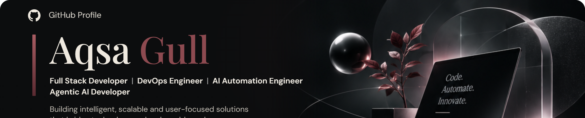</a>

<a href="https://aqsa-gull-official.vercel.app/contact">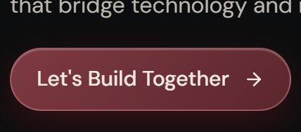</a><a href="https://github.com/Aqsagull99">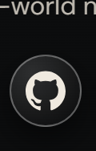</a>

<a href="https://aqsa-gull-official.vercel.app/">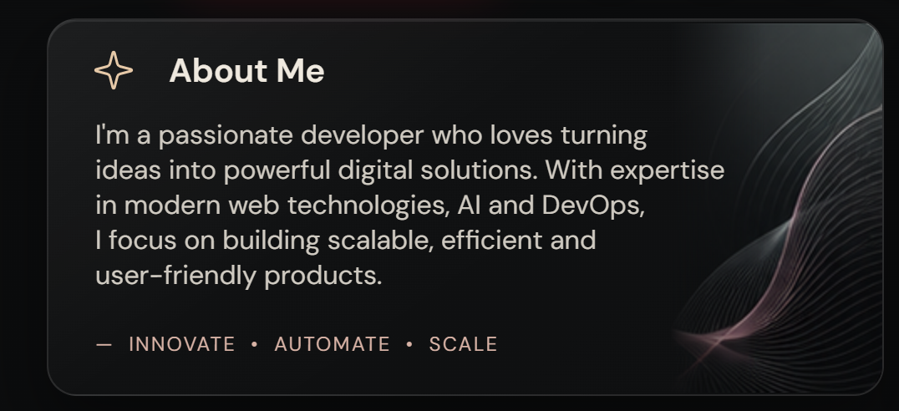</a><a href="https://aqsa-gull-official.vercel.app/expertise">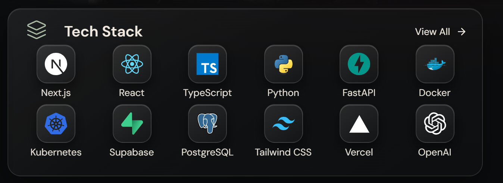</a>

<a href="https://aqsa-gull-official.vercel.app/#projects">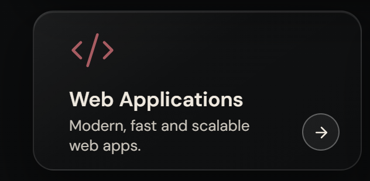</a><a href="https://aqsa-gull-official.vercel.app/#projects">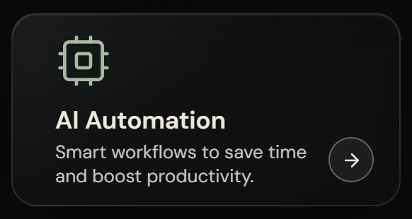</a><a href="https://github.com/Aqsagull99/Personal-Digital-FTE-Agent-Hackathon">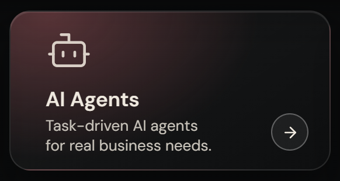</a><a href="https://github.com/Aqsagull99/hackathon-2-todo-app">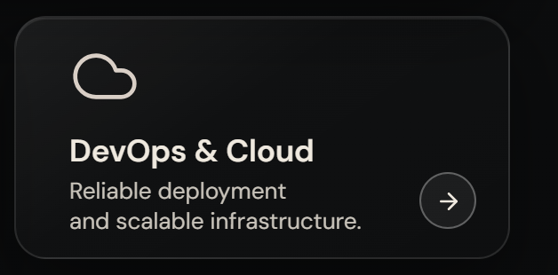</a>

<a href="https://github.com/Aqsagull99?tab=repositories">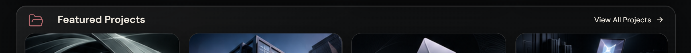</a>

<a href="https://aqsa-gull-official.vercel.app/#projects">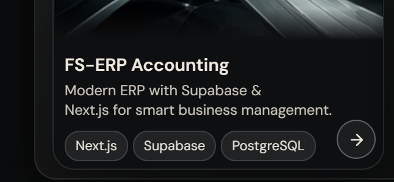</a><a href="https://luxe-ecommerce-website.vercel.app">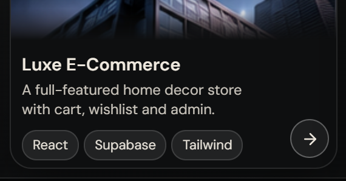</a><a href="https://aqsa-gull-official.vercel.app/#projects">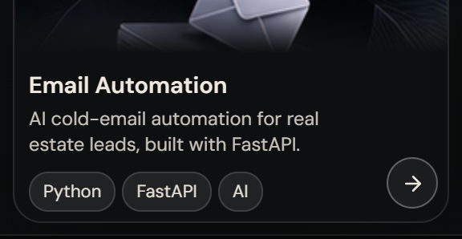</a><a href="https://aqsa-gull-official.vercel.app/#projects">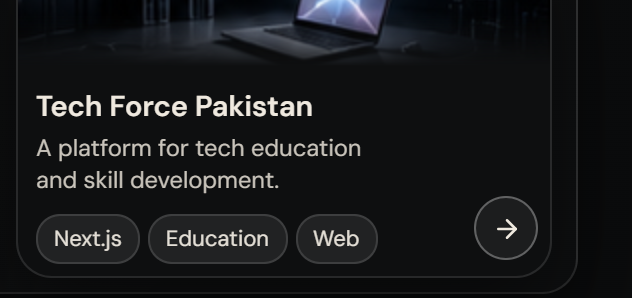</a>

<a href="https://github.com/Aqsagull99?tab=repositories&amp;q=agent">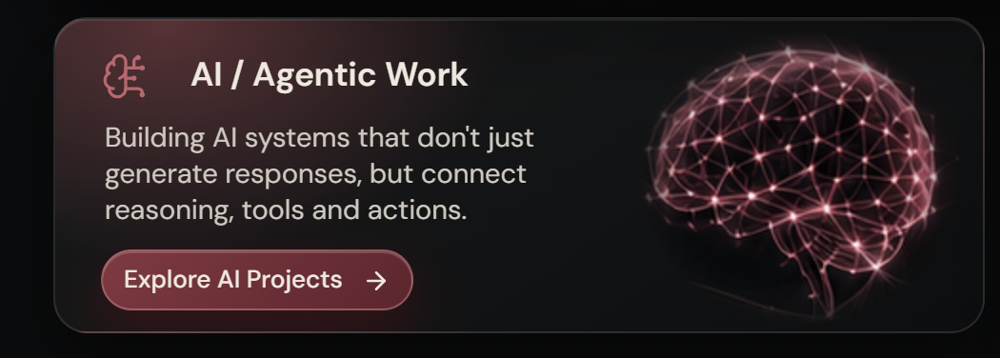</a><a href="https://github.com/Aqsagull99">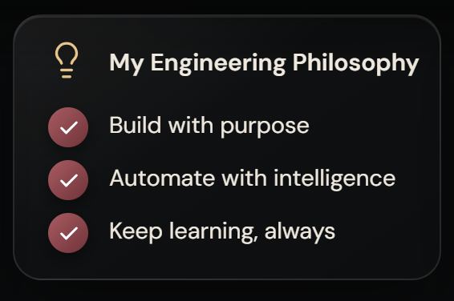</a><a href="https://github.com/Aqsagull99?tab=repositories">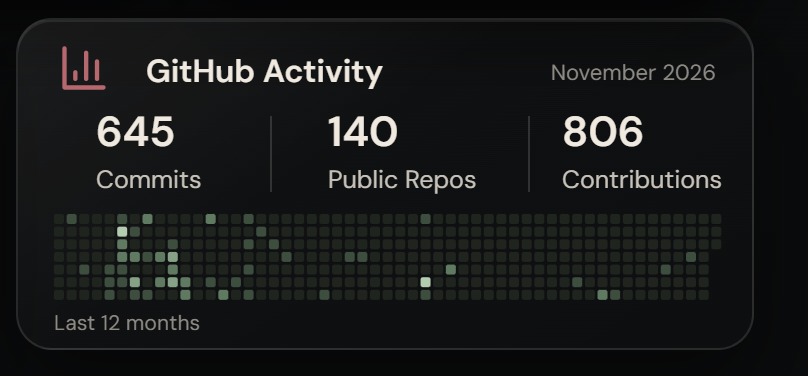</a>

<a href="https://aqsa-gull-official.vercel.app/contact">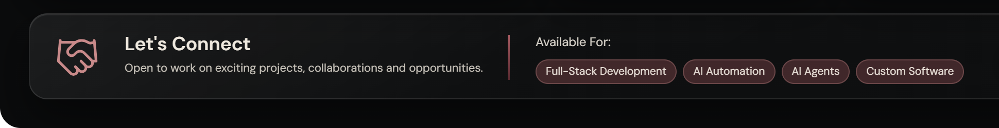</a><a href="https://aqsa-gull-official.vercel.app/">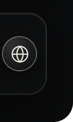</a>

<a href="https://aqsa-gull-official.vercel.app/">Portfolio</a> · <a href="https://linkedin.com/in/aqsa-gullofficial99">LinkedIn</a> · <a href="https://instagram.com/aqsa_gull99">Instagram</a> · <a href="mailto:aqsagull331@gmail.com">aqsagull331@gmail.com</a>

